# AI-ditor Plus Kullanım Kılavuzu

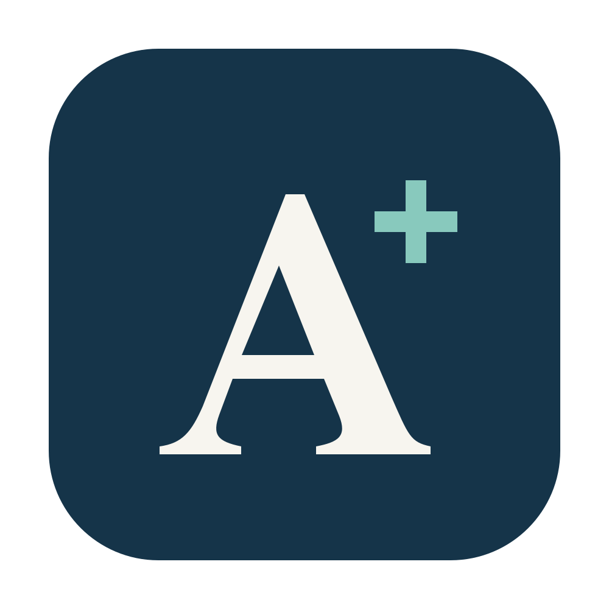

**Sürüm 2.3.0 için hazırlanmıştır.** Bu kılavuz, AI-ditor Plus'ı ilk kez kullanacak bir dergi editörünün kurulumdan Word/PDF çıktısına kadar bütün adımları tek başına tamamlayabilmesi için yazılmıştır. Ekran görüntüleri doğrudan uygulamadan alınmıştır; içlerindeki dergi, yazar, logo ve makale bilgileri **tamamen kurgusaldır**.

---

## İçindekiler

1. [AI-ditor Plus nedir?](#1-ai-ditor-plus-nedir)
2. [Kurulum](#2-kurulum)
3. [Hesap oluşturma ve giriş](#3-hesap-oluşturma-ve-giriş)
4. [Çalışma alanını tanıyın](#4-çalışma-alanını-tanıyın)
5. [Dergi tasarımı ve ayarları](#5-dergi-tasarımı-ve-ayarları)
6. [Makale hazırlama](#6-makale-hazırlama)
7. [Çıktı alma: Word ve PDF (Overleaf)](#7-çıktı-alma-word-ve-pdf-overleaf)
8. [Yedekleme ve başka bilgisayara taşıma](#8-yedekleme-ve-başka-bilgisayara-taşıma)
9. [Sık sorulan sorular ve sorun giderme](#9-sık-sorulan-sorular-ve-sorun-giderme)
10. [Yayın öncesi kontrol listesi](#10-yayın-öncesi-kontrol-listesi)

---

## 1. AI-ditor Plus nedir?

AI-ditor Plus, akademik dergilerin makalelerini **derginin kendi sayfa düzeniyle** yayına hazırlayan, kâr amacı gütmeden geliştirilmiş, MIT lisanslı açık kaynak bir masaüstü uygulamasıdır. Tek bir dergiye özel geliştirilen JGTTR Formatter'ın genel sürümü olarak düşünülebilir: Her dergi kendi hesabını açar, kendi logosunu, künyesini, tipografisini ve sayfa üst/alt bilgilerini bir kez tanımlar. Bu ayarlar daha sonra o derginin bütün makalelerinde kullanılır.

**Kimler için?** Dergi editörleri, yayın kurulu sekreterleri ve mizanpaj işini üstlenen akademisyenler.

**Ne yapar?**

- Yazarın gönderdiği Word (`.docx`) makaleyi okuyup başlık, özet, bölümler, tablolar, görseller ve kaynakçayı forma aktarır.
- Makaleyi seçtiğiniz dergi düzenine göre **düzenlenebilir Word (.docx)** belgesine veya **LaTeX/Overleaf projesine (ZIP)** dönüştürür. ZIP, Overleaf'te derlenerek PDF elde edilir.
- Metin içindeki APA yazar–yıl atıflarını kaynakçadaki ilgili kayda bağlar.
- Bütün makaleleri otomatik olarak kaydeder; kaldığınız yerden devam edersiniz.

**Temel kavramlar**

| Kavram | Anlamı |
| --- | --- |
| **Dergi hesabı** | Bu bilgisayarda oluşturulan, kullanıcı adı ve parolayla girilen çalışma alanı. Her derginin hesabı ve verileri ayrıdır. |
| **Dergi ayarları (ön ayar)** | Derginin adı, ISSN'i, logosu, şablonu, yazı tipi, dipnot ve üst/alt bilgi tercihleri. Bir kez yapılır, tüm makalelere uygulanır. |
| **Makale** | Kapak bilgileri, yazarlar, özet, bölümler, şekil/tablolar ve kaynakçadan oluşan kayıt. Arşivde saklanır. |
| **Çıktı** | Word belgesi (.docx) veya Overleaf'e yüklenecek LaTeX ZIP dosyası. |

**Genel iş akışı**

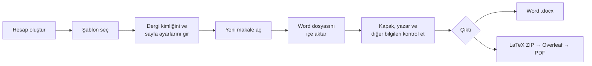

Adım 1–3 yalnızca bir kez yapılır. Her yeni makalede 4. adımdan devam edersiniz.

---

## 2. Kurulum

### macOS (13 veya üzeri)

1. [macOS kurulum dosyasını (DMG)](https://github.com/alparslanguvenc/aiditor-plus/releases/latest/download/AIditorPlus_Installer.dmg) indirin.
2. DMG'yi açın ve **AI-ditor Plus** simgesini **Applications** klasörüne sürükleyin.
3. Uygulamayı Applications klasöründen açın.

> **İlk açılışta uyarı alırsanız:** Uygulama Apple noter onayına sahip değildir. **Sistem Ayarları → Gizlilik ve Güvenlik** bölümüne gidip AI-ditor Plus için **Yine de Aç** düğmesine tıklayın. Bu işlem yalnızca bir kez gerekir.

### Windows

1. [Windows kurulum dosyasını](https://github.com/alparslanguvenc/aiditor-plus/releases/latest/download/AIditorPlus_Setup.exe) indirin ve çalıştırın.
2. Kurulum sihirbazını tamamlayıp uygulamayı Başlat menüsünden açın.

Windows sürümü pencere için Microsoft Edge WebView2 kullanır; bu bileşen güncel Windows 10/11 sistemlerinde genellikle hazır bulunur.

Her iki sistemde de uygulama kendi Python ortamını içerir; ayrıca bir şey kurmanız gerekmez. Uygulama yalnızca sizin bilgisayarınızda çalışır ve verilerinizi internete göndermez.

### Kaynak koddan çalıştırma (geliştiriciler için)

Python 3.11 veya üzeri gerekir:

```sh
python3 -m venv .venv
source .venv/bin/activate
python -m pip install -r requirements-desktop.txt
python app.py
```

Uygulamayı masaüstü penceresi yerine tarayıcıda açmak için `python app.py --browser` komutunu kullanın.

---

## 3. Hesap oluşturma ve giriş

Uygulama açıldığında giriş ekranı gelir. Sağdaki kartta **Giriş yap** ve **Hesap oluştur** sekmeleri bulunur.

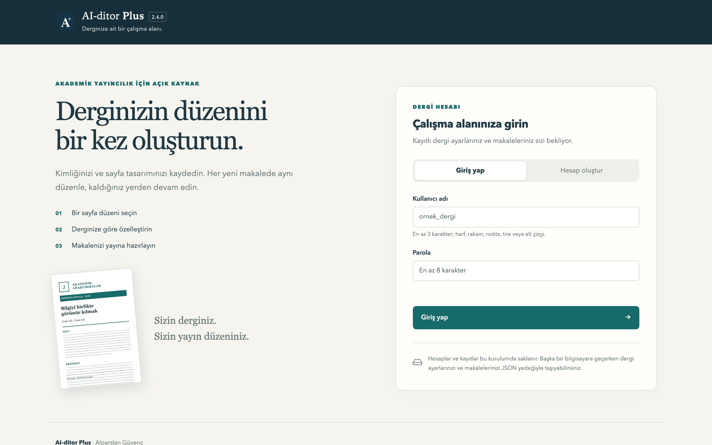

### İlk kez kullanıyorsanız: Hesap oluşturun

1. **Hesap oluştur** sekmesine tıklayın.
2. **Dergi adı:** Derginizin adını yazın. Bu ad, çalışma alanının başlığında ve dergi ayarlarında kullanılır; sonradan değiştirebilirsiniz.
3. **Kullanıcı adı:** En az 3 karakter. Yalnızca harf, rakam, nokta (`.`), tire (`-`) ve alt çizgi (`_`) kullanılabilir. Örnek: `ornek_dergi`.
4. **Parola:** En az 8 karakter.
5. **Hesap oluştur →** düğmesine tıklayın.

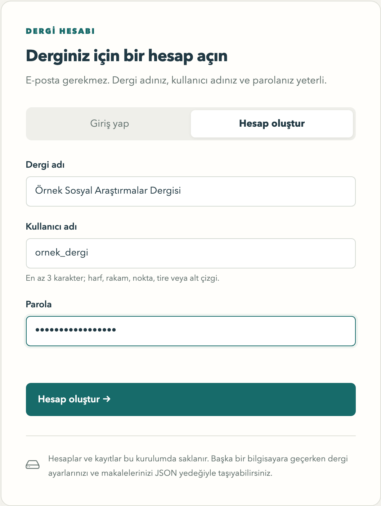

E-posta adresi gerekmez. Hesap yalnızca bu bilgisayardaki kurulumda saklanır; bulut hesabı veya cihazlar arası eşitleme yoktur.

> **Önemli:** Uygulamada parola sıfırlama özelliği yoktur. Parolanızı güvenli bir yerde saklayın ve [8. bölümde](#8-yedekleme-ve-başka-bilgisayara-taşıma) anlatılan JSON yedeklerini düzenli olarak alın. Parolayı unutursanız yeni bir hesap açıp yedeklerinizi içe aktararak çalışmaya devam edebilirsiniz.

### Sonraki kullanımlarda: Giriş yapın

**Giriş yap** sekmesinde kullanıcı adınızı ve parolanızı yazıp **Giriş yap** düğmesine tıklayın. Dergi ayarlarınız ve makaleleriniz kaldığınız gibi açılır.

Birden fazla dergiyle çalışıyorsanız her dergi için ayrı hesap açın. Hesaplar birbirinin ayarlarını ve makalelerini göremez. Hesap değiştirmek için sağ üstteki **Çıkış yap** düğmesini kullanın.

---

## 4. Çalışma alanını tanıyın

Giriş yaptıktan sonra derginizin çalışma alanı açılır.

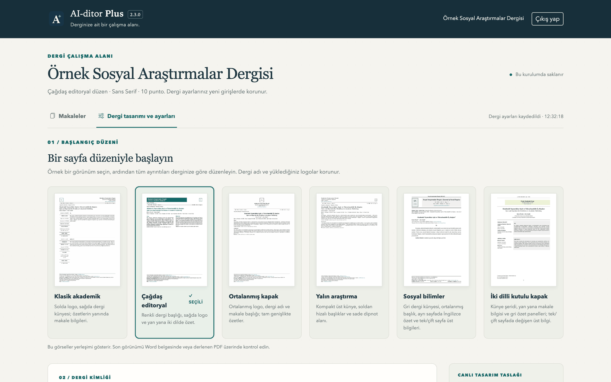

- **Üst şerit:** Uygulama sürümü, açık olan derginin adı ve **Çıkış yap** düğmesi.
- **Başlık alanı:** Derginin adı ve seçili düzenin kısa özeti (ör. *Çağdaş editoryal düzen · Sans Serif · 10 punto*). Sağdaki **Bu kurulumda saklanır** ifadesi verilerin yerel olarak tutulduğunu hatırlatır.
- **İki sekme:**
  - **Makaleler:** Makale arşivi ve makale düzenleyicisi.
  - **Dergi tasarımı ve ayarları:** Derginin bir kez yapılan bütün ayarları.
- **Kayıt durumu:** Sekmelerin sağında *Dergi ayarları kaydedildi · saat* gibi bir ifade görünür. Ayarlar otomatik kaydedilir.

Yeni bir hesapla ilk girişte önce **Dergi tasarımı ve ayarları** sekmesini tamamlamanızı öneririz. Böylece açtığınız her makale doğrudan doğru düzenle başlar.

---

## 5. Dergi tasarımı ve ayarları

Bu sekme altı numaralı bölümden oluşur. Yaptığınız her değişiklik otomatik kaydedilir ve sağ taraftaki **Canlı tasarım taslağı** üzerinde hemen görünür.

### 5.1 Başlangıç düzenini seçin (01)

Derginizin ilk sayfa görünümüne en yakın şablona tıklayın. Seçili şablonun üzerinde **✓ SEÇİLİ** işareti görünür.

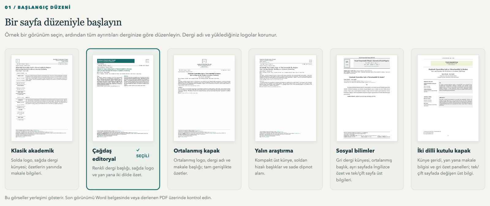

| Şablon | Ne zaman uygun? |
| --- | --- |
| **Klasik akademik** | Solda logo, sağda dergi künyesi; özetlerin yanında makale bilgileri olan geleneksel düzen. |
| **Çağdaş editoryal** | Renkli dergi başlığı, sağda logo ve yan yana iki dilde özet. |
| **Ortalanmış kapak** | Ortalanmış logo, dergi adı ve makale başlığı; tam genişlikte özetler. |
| **Yalın araştırma** | Kompakt üst künye, soldan hizalı başlıklar ve sade dipnot alanı. |
| **Sosyal bilimler** | Gri dergi künyesi, ortalanmış başlık, ayrı sayfada İngilizce özet, tek/çift sayfa üst bilgileri. |
| **İki dilli kutulu kapak** | Künye şeridi, yan yana makale bilgisi ve gri özet panelleri, tek/çift sayfada değişen üst bilgi. |

Şablon seçmek dergi adınızı ve yüklediğiniz logoları **silmez**; yalnızca yerleşim, renk ve tipografi ayarlarını değiştirir. Şablonlar arasında istediğiniz zaman geçiş yapabilirsiniz.

Şablonların gerçek çıktıdaki görünümü için örnekler:

| Çağdaş editoryal | Sosyal bilimler | İki dilli kutulu kapak |
| --- | --- | --- |
| 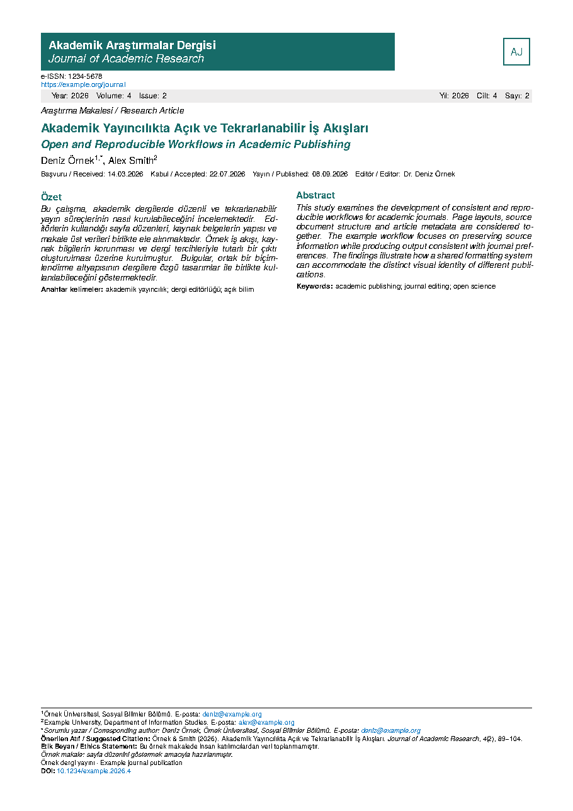 | 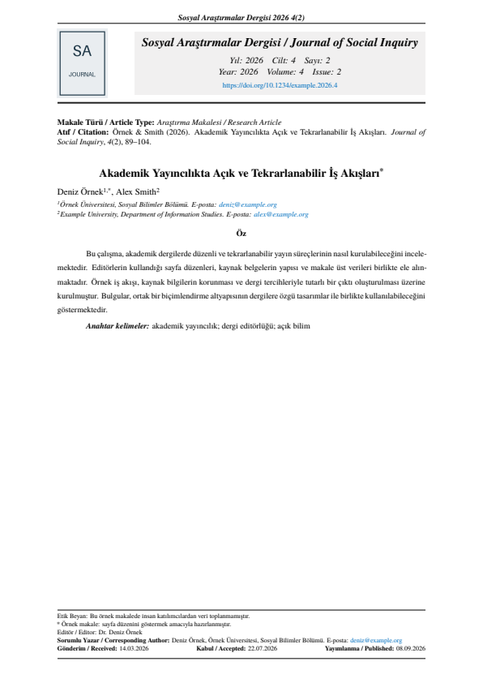 | 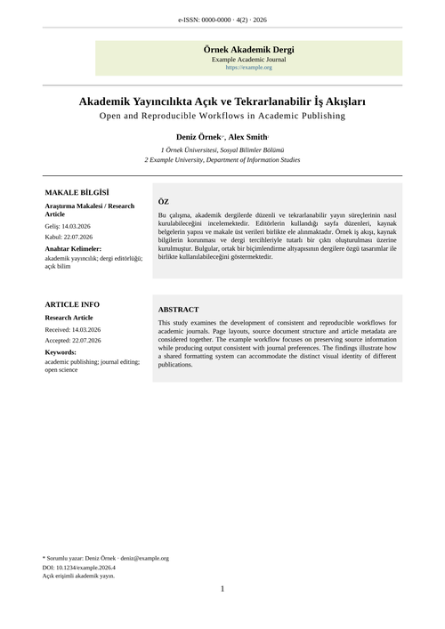 |

### 5.2 Dergi kimliği (02)

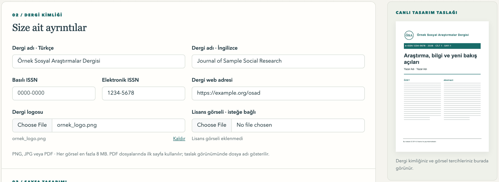

| Alan | Açıklama |
| --- | --- |
| **Dergi adı · Türkçe / İngilizce** | Kapakta ve üst bilgilerde kullanılır. İngilizce ad, önerilen atıf satırında da yer alır. |
| **Basılı ISSN / Elektronik ISSN** | `0000-0000` biçiminde girin. Boş bırakılanlar çıktıda görünmez. |
| **Dergi web adresi** | Kapaktaki künyede bağlantı olarak gösterilir. |
| **Dergi logosu** | PNG, JPG veya PDF (en fazla 8 MB). PDF'lerde ilk sayfa kullanılır. **Kaldır** bağlantısıyla silinebilir. |
| **Lisans görseli · isteğe bağlı** | Örneğin CC BY rozeti. Dergi lisans görseli kullanıyorsa ekleyin. |

Sağdaki **Canlı tasarım taslağı**, logonuzun, renginizin ve dergi adınızın ilk sayfada nasıl duracağını gösterir. Bu bir yerleşim taslağıdır; son görünümü her zaman Word belgesinde veya derlenen PDF'te kontrol edin.

### 5.3 Yerleşim ve tipografi (03)

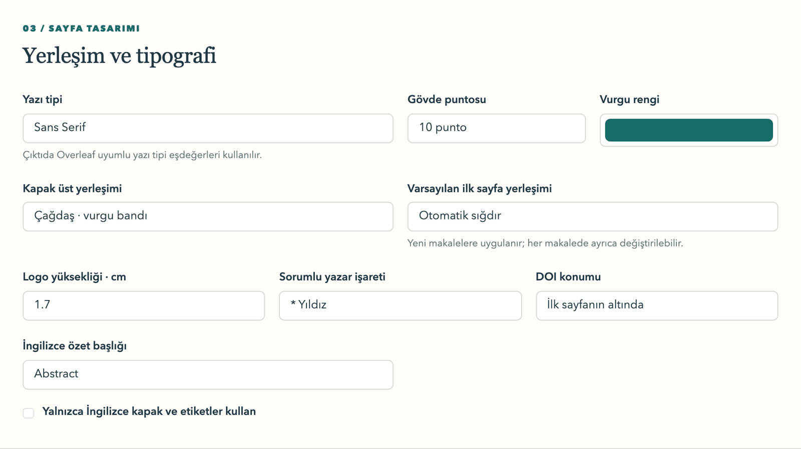

- **Yazı tipi:** Palatino Linotype, Times New Roman, Century, Calibri, Sans Serif veya Latin Modern. LaTeX çıktısında Overleaf uyumlu eşdeğerleri kullanılır.
- **Gövde puntosu:** 10, 11 veya 12 punto.
- **Vurgu rengi:** Başlık bandı, başlıklar ve çizgilerde kullanılan renk. Renk kutusuna tıklayarak seçin.
- **Kapak üst yerleşimi:** Kapak başlığının yapısı. Şablon seçince otomatik ayarlanır; isterseniz şablondan bağımsız değiştirebilirsiniz.
- **Varsayılan ilk sayfa yerleşimi:** *Otomatik sığdır*, *Sıkı* veya *Çok sıkı*. Yeni makalelere uygulanır; her makalede ayrıca değiştirilebilir.
- **Logo yüksekliği (cm):** 0,5–3,5 cm arası.
- **Sorumlu yazar işareti:** \*, †, ‡, §, ¶, #, ★ veya ✉.
- **DOI konumu:** İlk sayfanın altında veya üst bilgi alanında.
- **İngilizce özet başlığı:** “Abstract”, “Extended Summary” ya da kendi ifadeniz.
- **Yalnızca İngilizce kapak ve etiketler kullan:** Derginiz yalnızca İngilizce yayın yapıyorsa işaretleyin; kapaktaki etiketler ve bölüm adları İngilizce oluşturulur.

### 5.4 Dipnot ve lisans (04)

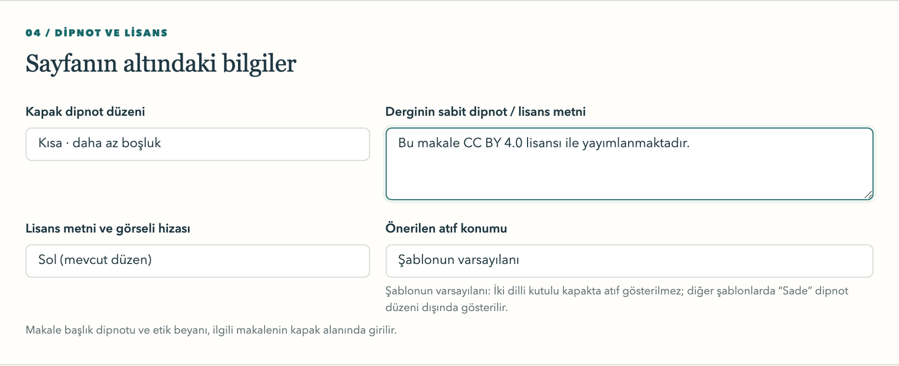

- **Kapak dipnot düzeni:** *Ayrıntılı · tüm bilgiler*, *Kısa · daha az boşluk* veya *Sade · temel bilgiler*. İlk sayfanın altındaki yazar bilgileri, önerilen atıf, etik beyan ve DOI bloğunun yoğunluğunu belirler.
- **Derginin sabit dipnot / lisans metni:** Her makalenin ilk sayfasının altında görünecek sabit ifade (ör. *Bu makale CC BY 4.0 lisansı ile yayımlanmaktadır.*).
- **Lisans metni ve görseli hizası:** Sabit dipnot/lisans metninin ve lisans görselinin ilk sayfanın altında *Sol* (mevcut düzen), *Orta* veya *Sağ* tarafta yer almasını sağlar. Word ve PDF çıktısına birlikte uygulanır.
- **Önerilen atıf konumu:** Makalenin önerilen atıfının (ör. *Örnek & Smith (2026). Başlık. Dergi, 3(2), 45–62.*) ilk sayfadaki yerini belirler:

  | Seçenek | Sonuç |
  | --- | --- |
  | **Şablonun varsayılanı** | Şablonun özgün davranışı korunur. İki dilli kutulu kapakta atıf yer almaz; diğer şablonlarda “Sade” dipnot düzeni seçili değilse gösterilir. |
  | **Yazar bilgilerinin altında, özetlerden önce** | Atıf, yazar ve kurum bilgilerinin hemen altında yer alır. İki dilli kutulu kapak için önerilen seçenektir. |
  | **İlk sayfanın altındaki dipnotta** | Atıf, sayfa altındaki kapak notlarına eklenir. |
  | **Gösterme** | Atıf ilk sayfada gösterilmez. |

Makaleye özel başlık dipnotu ve etik beyan buraya değil, ilgili makalenin kapak bilgilerine yazılır ([6.3](#63-kapak-sayfası-bilgileri-1)).

### 5.5 Sayfa üst ve alt bilgileri (05)

Bu bölüm, makalenin bütün sayfalarında yer alan üst bilgi (header) ve alt bilgiyi (footer) belirler. Ayarlar hem Word hem LaTeX çıktısında aynı şekilde uygulanır.

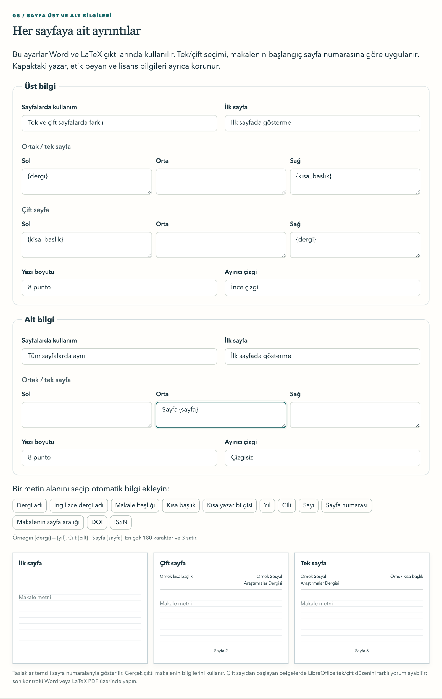

**Sayfalarda kullanım** seçenekleri:

| Seçenek | Sonuç |
| --- | --- |
| **Mevcut düzen** | Seçtiğiniz şablonun varsayılan üst/alt bilgisi kullanılır. |
| **Tüm sayfalarda aynı** | Her sayfada aynı sol/orta/sağ içerik görünür. |
| **Tek ve çift sayfalarda farklı** | Kitap düzeninde olduğu gibi tek ve çift sayfalara ayrı içerik yazılır (ör. tek sayfada dergi adı, çift sayfada kısa başlık). |
| **Gizle** | Üst/alt bilgi kullanılmaz. |

**İlk sayfa** için ayrıca *İlk sayfada gösterme*, *Sayfa düzenini uygula* veya *İlk sayfaya özel* seçeneklerinden birini seçebilirsiniz. Her alan için **Yazı boyutu** (7–10 punto) ve **Ayırıcı çizgi** (çizgisiz veya ince çizgi) ayarlanabilir.

**Otomatik bilgi ekleme:** Sol/Orta/Sağ kutularından birine tıklayın, ardından alttaki düğmelerden birini seçin. Düğme, kutuya süslü parantezli bir etiket ekler; çıktıda bu etiket makalenin gerçek bilgisiyle değiştirilir.

| Düğme | Etiket | Çıktıda |
| --- | --- | --- |
| Dergi adı | `{dergi}` | Türkçe dergi adı |
| İngilizce dergi adı | `{dergi_en}` | İngilizce dergi adı |
| Makale başlığı | `{baslik}` | Makalenin başlığı |
| Kısa başlık | `{kisa_baslik}` | Kapaktaki *Kısa Başlık* alanı; boşsa makale başlığı (100 karakterden uzunsa kısaltılır) |
| Kısa yazar bilgisi | `{yazarlar}` | Kapaktaki *Kısa Yazar* alanı; boşsa yazar soyadlarından oluşturulur |
| Yıl / Cilt / Sayı | `{yil}` `{cilt}` `{sayi}` | Makalenin künye bilgileri |
| Sayfa numarası | `{sayfa}` | Bulunulan sayfanın numarası |
| Makalenin sayfa aralığı | `{sayfa_araligi}` | Ör. 45–62; bitiş sayfası boşsa otomatik hesaplanır |
| DOI / ISSN | `{doi}` `{issn}` | Makale DOI'si / dergi ISSN'i |

Etiketleri serbest metinle birleştirebilirsiniz; ör. `{dergi} – {yil}, Cilt {cilt}` veya `Sayfa {sayfa}`. Her kutu en fazla 180 karakter ve 3 satır alır. Bölümün altındaki **İlk sayfa / Çift sayfa / Tek sayfa** taslakları seçimlerinizi anında gösterir.

> Tek/çift sayfa seçimi, makalenin başlangıç sayfa numarasına göre uygulanır. LibreOffice çift sayıdan başlayan belgelerde bu düzeni farklı yorumlayabilir; son kontrolü Microsoft Word'de veya LaTeX PDF'inde yapın.

### 5.6 Atıf bağlantıları (06) ve kaydetme

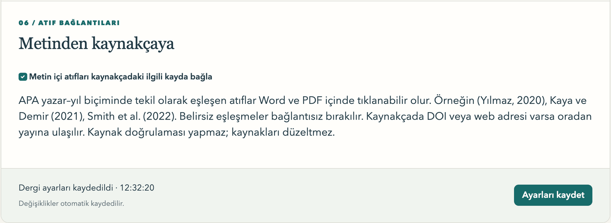

**Metin içi atıfları kaynakçadaki ilgili kayda bağla** seçeneği açıkken `(Yılmaz, 2020)`, `Kaya ve Demir (2021)`, `Smith et al. (2022)` gibi APA yazar–yıl atıfları Word ve PDF içinde tıklanabilir hâle gelir ve okuru kaynakçadaki kayda götürür. Kaynakçada DOI veya web adresi varsa oradan yayına ulaşılır. Belirsiz eşleşmeler bağlantısız bırakılır; uygulama kaynakların doğruluğunu denetlemez ve kaynak metnini değiştirmez.

Sayfanın en altındaki kayıt çubuğu ayarların durumunu gösterir (*Dergi ayarları kaydedildi · saat*). Ayarlar zaten otomatik kaydedilir; **Ayarları kaydet** düğmesi, bir kayıt hatasından sonra yeniden denemek ya da kaydı elle onaylamak içindir.

### 5.7 Dergi ayarlarını yedekleme

Sağ sütundaki **Ayarlarınız taşınabilir** kartı, dergi ayarlarınızı logolarıyla birlikte tek bir JSON dosyasına kaydeder.

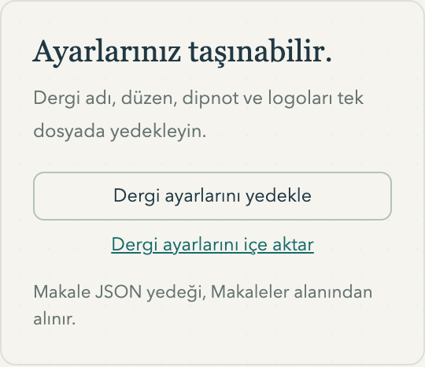

- **Dergi ayarlarını yedekle:** Ayarları ve logoları `.json` dosyası olarak indirir.
- **Dergi ayarlarını içe aktar:** Daha önce alınmış bir yedeği geri yükler. Geçersiz bir dosya seçerseniz mevcut ayarlarınız korunur.

---

## 6. Makale hazırlama

**Makaleler** sekmesine geçin. Sayfanın üstünde makale arşivi, altında makale düzenleyicisi bulunur.

### 6.1 Makale arşivi

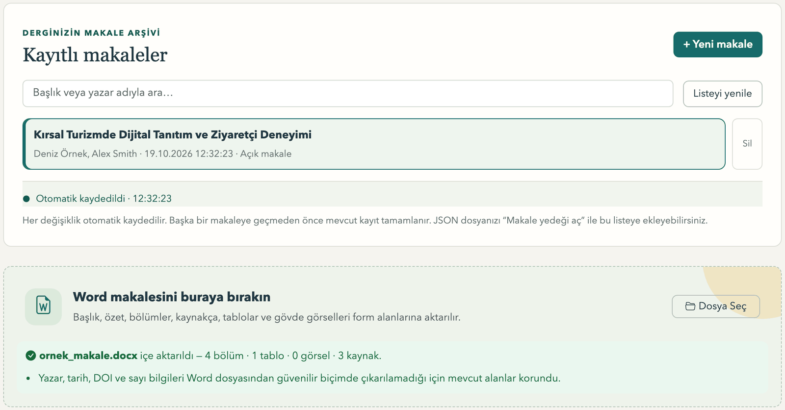

- **+ Yeni makale:** Boş bir makale açar. Dergi ayarlarınız (ör. ilk sayfa yerleşimi) yeni makaleye otomatik uygulanır.
- **Arama kutusu:** Kayıtlı makaleleri başlık veya yazar adıyla filtreler.
- **Makale kartı:** Başlık, yazarlar ve son kayıt zamanını gösterir. Bir makaleyi açmak için kartına tıklayın; açık olan makale *Açık makale* olarak işaretlenir.
- **Sil:** Makaleyi arşivden kaldırır. Onay istenir ve silinen kayıt geri getirilemez; gerekiyorsa önce JSON yedeği alın.
- **Otomatik kayıt göstergesi:** *Otomatik kaydedildi · saat* yazısı, son değişikliğin diske yazıldığını gösterir. Başka bir makaleye geçmeden önce mevcut kayıt tamamlanır.

> **Kayıt hatası görürseniz** gösterge kırmızıya döner ve **Yeniden dene** düğmesi çıkar. Değişiklikleriniz ekranda korunur; düğmeye tıklayarak kaydı tamamlayın. Aynı makale iki pencerede birden düzenlenirse uygulama sessizce üzerine yazmaz; **Yeni kayıt olarak koru** düğmesiyle ikinci penceredeki değişiklikleri ayrı bir kopya olarak saklayabilirsiniz.

### 6.2 Word makalesini içe aktarma

Makaleyi elle yazmak yerine yazarın gönderdiği Word dosyasını içe aktarmak en hızlı yoldur:

1. **+ Yeni makale** ile boş bir makale açın.
2. `.docx` dosyasını **Word makalesini buraya bırakın** alanına sürükleyin ya da **Dosya Seç** düğmesine tıklayın.
3. Aktarım bitince alanın altında bir özet görünür, ör. *ornek_makale.docx içe aktarıldı – 4 bölüm · 1 tablo · 0 görsel · 3 kaynak.*

Uygulama başlıkları, Türkçe/İngilizce özetleri ve anahtar kelimeleri, bölüm başlıklarını ve paragrafları, tabloları (birleşik hücreler dâhil), gövdedeki görselleri ve kaynakçayı kaynak belgedeki sırasıyla forma yerleştirir. Başlıkların dili otomatik tanınır: Word dosyasında İngilizce başlık önce gelse bile Türkçe başlık *Türkçe Başlık*, İngilizce başlık *İngilizce Başlık* alanına yerleştirilir. Yalnızca İngilizce başlık varsa Türkçe başlık alanı boş bırakılır.

**Aktarılmayan bilgiler:** Yazar, tarih, DOI, cilt/sayı gibi künye bilgileri Word dosyalarında standart bir yerde bulunmadığı için güvenilir biçimde çıkarılamaz. Bu alanlar boş kalır veya mevcut değerleri korunur; bunları sonraki adımlarda elle girersiniz. Resim olarak çizilmiş tablolar, Word şekilleri ve metin kutuları da her belgede aktarılamayabilir.

> **İpucu:** Word dosyasında bölüm başlıkları için Word'ün *Başlık 1/2/3* stillerini, makale başlığı için *Konu Başlığı* stilini kullanmak aktarımın doğruluğunu artırır. Özet bölümlerinin “Öz/Özet” ve “Abstract” başlıklarıyla, anahtar kelime satırlarının “Anahtar Kelimeler:” ve “Keywords:” ifadeleriyle başlaması da aktarımı kolaylaştırır.

İçe aktarmadan sonra aşağıdaki yedi bölümü sırayla kontrol edin. Her bölümün başlığına tıklayarak bölümü açıp kapatabilirsiniz.

### 6.3 Kapak sayfası bilgileri (1)

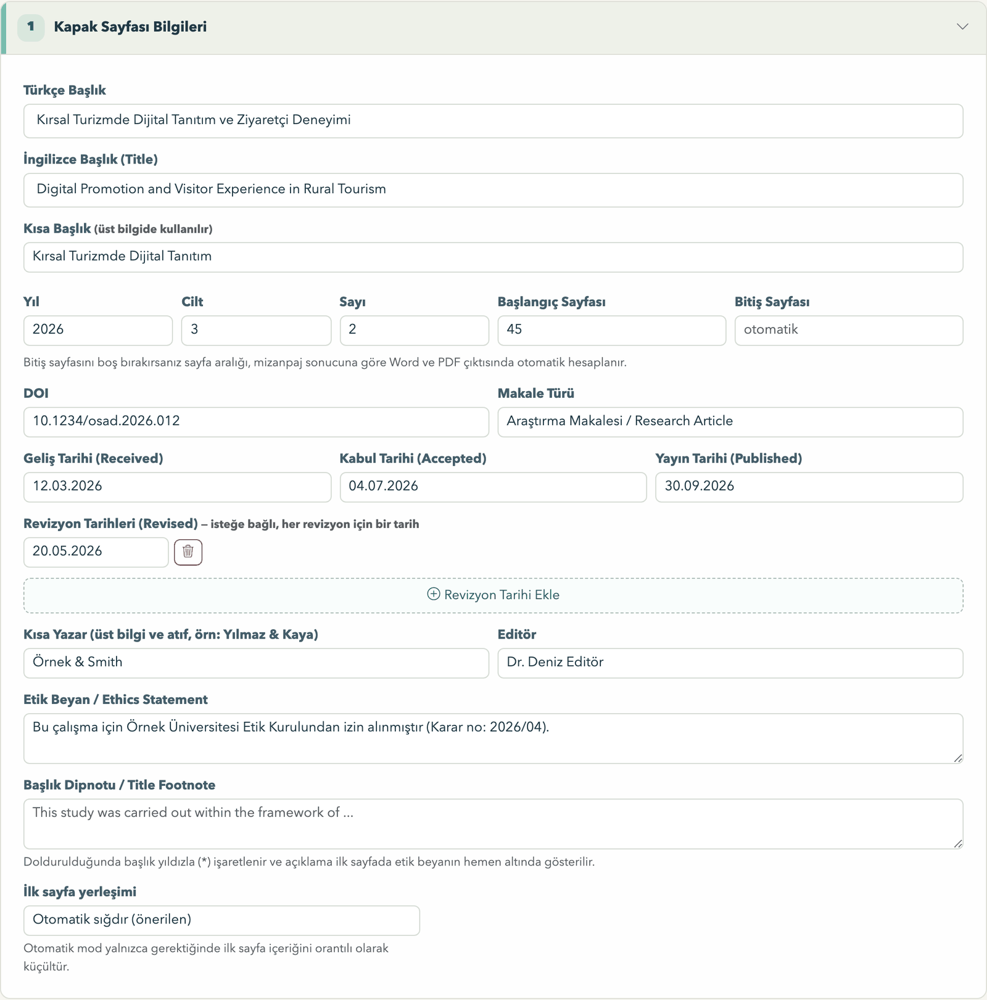

| Alan | Açıklama |
| --- | --- |
| **Türkçe Başlık / İngilizce Başlık** | Word'den aktarılır; gerekirse düzeltin. |
| **Kısa Başlık** | Üst bilgilerdeki `{kisa_baslik}` alanında kullanılır (ör. *Kırsal Turizmde Dijital Tanıtım*). Boş bırakılırsa makale başlığı kullanılır. |
| **Yıl, Cilt, Sayı** | Künyede ve üst bilgilerde kullanılır. |
| **Başlangıç Sayfası** | Sayfa numaraları bu değerden başlar; tek/çift üst bilgiler de buna göre belirlenir. |
| **Bitiş Sayfası** | **Boş bırakmanız önerilir.** Boşsa son sayfa, mizanpaj tamamlandıktan sonra Word ve PDF çıktısında otomatik hesaplanır; sayfa aralığı (ör. 45–62) künyede, atıfta ve üst bilgilerde kendiliğinden doğru görünür. Elle yazdığınız bitiş sayfası her zaman önceliklidir. |
| **DOI** | Yalnızca `10.xxxx/...` kısmını yazın; çıktıda `https://doi.org/` bağlantısı oluşturulur. |
| **Makale Türü** | Listeden seçin veya `Türkçe -- English` biçiminde yazın (ör. *Araştırma Makalesi -- Research Article*). İki dilli kutulu kapakta Türkçe kısmı Öz panelinde, İngilizce kısmı Abstract panelinde gösterilir. |
| **Geliş / Kabul / Yayın Tarihi** | `gg.aa.yyyy` biçiminde. |
| **Revizyon Tarihleri** | İsteğe bağlı. **Revizyon Tarihi Ekle** ile her revizyon için ayrı bir tarih girin; çöp kutusu simgesi tarihi siler. Tarihler geliş ve kabul tarihleri arasında listelenir; iki dilli kutulu kapakta özetlerin solundaki makale bilgisi alanında *Revizyon 1, Revizyon 2…* olarak görünür. |
| **Kısa Yazar** | Üst bilgide ve önerilen atıfta kullanılan kısa yazar bilgisi (ör. *Örnek & Smith*). Yıl atıfa ayrıca eklendiği için buraya yalnızca soyadlarını yazın; yanlışlıkla yıl yazılırsa tekrarlanmaz. Boş bırakılırsa yazar adlarından otomatik oluşturulur. |
| **Editör** | Makaleden sorumlu editör; ilk sayfada gösterilir. |
| **Etik Beyan** | Etik kurul izni vb. Boş bırakılırsa çıktıya eklenmez; uygulama bu alanı kendiliğinden doldurmaz. |
| **Başlık Dipnotu** | Doldurulursa başlık yıldızla (\*) işaretlenir ve açıklama ilk sayfada etik beyanın hemen altında gösterilir (ör. tezden üretilmiştir, bildiri olarak sunulmuştur). |
| **İlk sayfa yerleşimi** | *Otomatik sığdır (önerilen)*, *Sıkı* veya *Çok sıkı*. Uzun özetli veya çok yazarlı makalelerde ilk sayfa taşıyorsa sıkı seçeneklerini deneyin. |

### 6.4 Yazarlar (2)

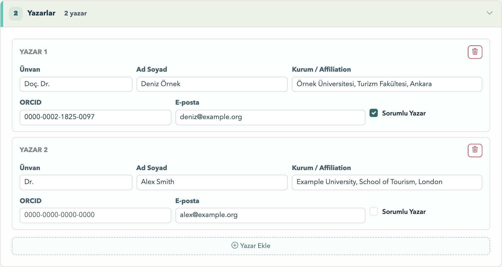

- **Yazar Ekle** ile her yazar için yeni bir satır açın; çöp kutusu simgesi yazarı siler.
- **Ünvan** listeden seçilebilir (Prof. Dr., Doç. Dr., Dr. Öğr. Üyesi …) veya serbestçe yazılabilir.
- **Kurum / Affiliation:** Bölüm, üniversite ve şehir.
- **ORCID:** `0000-0000-0000-0000` biçiminde; çıktıda ORCID bağlantısına dönüşür.
- **E-posta** ve **Sorumlu Yazar** işareti: Sorumlu yazar, dergi ayarlarında seçtiğiniz işaretle (ör. \*) belirtilir.

Yazarların sırası çıktıdaki sıradır.

### 6.5 Özet / Abstract (3)

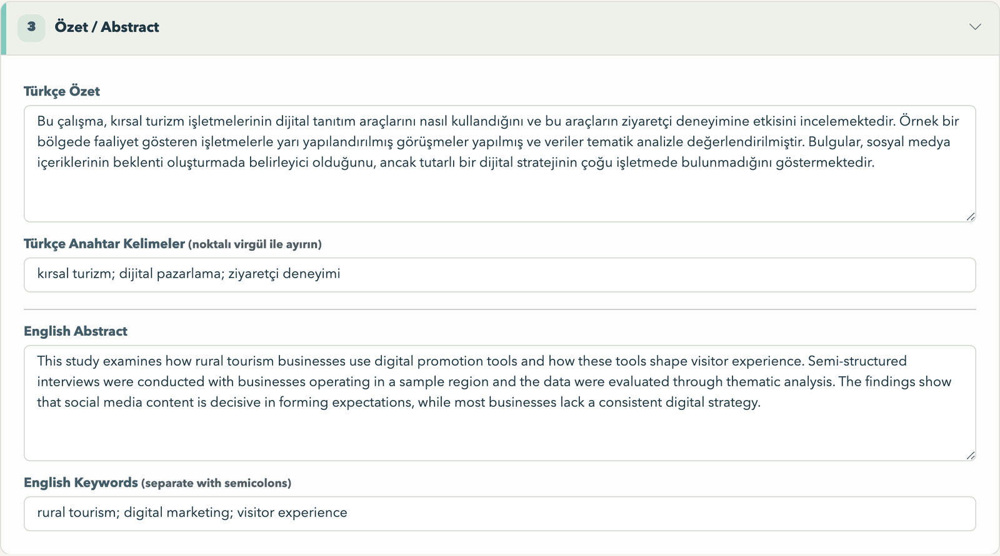

Türkçe özet, Türkçe anahtar kelimeler, İngilizce özet (Abstract) ve İngilizce anahtar kelimeler (Keywords) alanlarını kontrol edin. Anahtar kelimeleri **noktalı virgülle** ayırın: `kırsal turizm; dijital pazarlama; ziyaretçi deneyimi`.

### 6.6 Makale bölümleri (4)

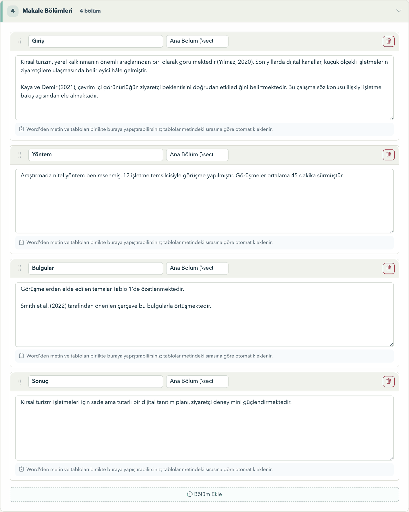

Her bölüm bir başlık, bir düzey ve bir metin alanından oluşur.

- **Bölüm adı:** Soldaki kutuda düzenlenir.
- **Düzey:** *Ana Bölüm*, *Alt Bölüm* veya *Alt-Alt* bölüm. Başlık numaralandırması ve büyüklüğü buna göre oluşturulur.
- **Sıralama:** Soldaki tutamaç simgesinden (⋮⋮) tutup sürükleyin. Klavye kullanıyorsanız tutamaca odaklanıp **↑ / ↓** tuşlarıyla taşıyın. Şekil ve tablo bağlantıları bölüm adı veya sırası değişse de korunur.
- **Paragraflar:** Paragrafları boş bir satırla ayırın.
- **Word'den yapıştırma:** Bir metin alanına Word'den kopyaladığınız metin ve tabloları birlikte yapıştırabilirsiniz; tablolar metindeki sırasına göre otomatik olarak *Şekil ve Tablolar* bölümüne eklenir.
- **Bölüm Ekle** yeni bölüm açar; çöp kutusu simgesi bölümü siler.

### 6.7 Şekil ve tablolar (5)

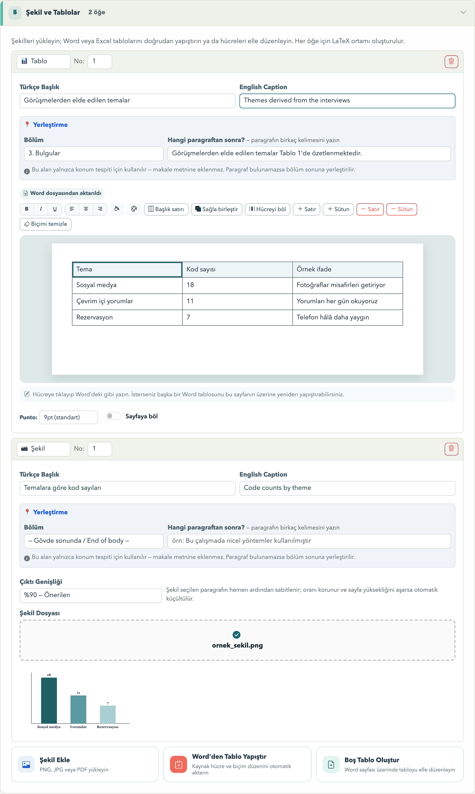

Alt kısımdaki üç düğmeyle yeni öğe eklenir:

- **Şekil Ekle:** PNG, JPG veya PDF görsel yükleyin.
- **Word'den Tablo Yapıştır:** Word veya Excel'de tabloyu kopyalayıp açılan alana yapıştırın; hücre birleştirmeleri ve biçimler aktarılır.
- **Boş Tablo Oluştur:** Tabloyu sıfırdan, hücrelere tıklayarak doldurun.

Her öğe için:

1. **Tür ve No:** Şekil/Tablo ve numarası (otomatik verilir, değiştirilebilir).
2. **Türkçe Başlık / English Caption:** Çıktıda “Tablo 1. … / …” biçiminde gösterilir.
3. **Yerleştirme:** Öğenin hangi **bölümde** ve **hangi paragraftan sonra** yer alacağını seçin. Paragraf için o paragrafın ilk birkaç kelimesini yazmanız yeterlidir; bu metin makaleye eklenmez, yalnızca konumu bulmak için kullanılır. Paragraf bulunamazsa öğe bölümün sonuna yerleştirilir.
4. **Tablo araç çubuğu:** Kalın / italik / altı çizili, hizalama, hücre ve yazı rengi, *Başlık satırı*, *Sağla birleştir*, *Hücreyi böl*, satır/sütun ekleme ve silme, *Biçimi temizle*. Bir hücreye tıklayıp Word'deki gibi yazabilirsiniz.
5. **Punto ve Sayfaya böl:** Tablo yazı boyutu ve uzun tabloların sayfalara bölünmesine izin verme.
6. **Çıktı Genişliği (şekiller):** Görselin metin genişliğine oranı (%90 önerilir). Oran korunur; sayfadan uzun görseller otomatik küçültülür.

### 6.8 Ek bölümler (6)

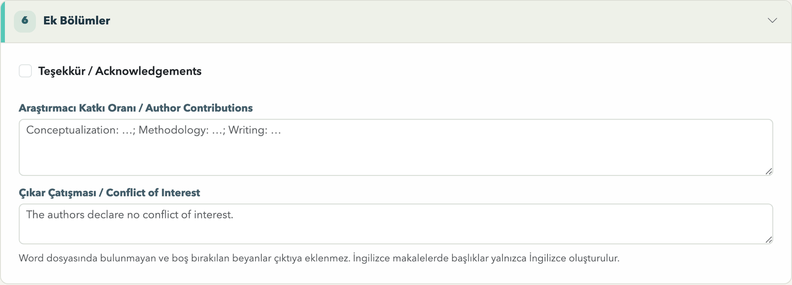

- **Teşekkür / Acknowledgements:** Kutuyu işaretleyince metin alanı açılır.
- **Araştırmacı Katkı Oranı / Author Contributions**
- **Çıkar Çatışması / Conflict of Interest**

Word dosyasında bulunmayan ve boş bırakılan beyanlar çıktıya eklenmez. İngilizce makalelerde bu başlıklar yalnızca İngilizce oluşturulur.

### 6.9 Kaynakça (7)

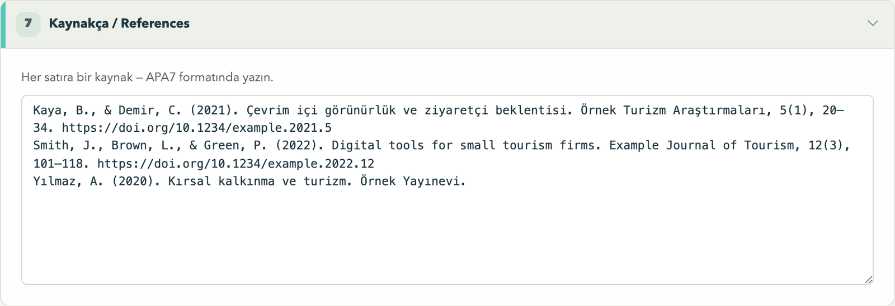

Her satıra **bir kaynak** gelecek şekilde, APA 7 biçiminde yazın. Kaynaklar Word'den aktarıldıysa satırların doğru bölündüğünü kontrol edin. DOI'leri `https://doi.org/...` biçiminde bırakın; çıktıda tıklanabilir olurlar ve atıf bağlantılarının çalışması için de gereklidir.

---

## 7. Çıktı alma: Word ve PDF (Overleaf)

Düzenleyicinin en altında makale yedeği ve çıktı düğmeleri bulunur.

### 7.1 Düzenlenebilir Word (.docx)

1. **Word (.docx) oluştur** düğmesine tıklayın.
2. *Tamamlandı – Word belgesi hazır* panelinde **Word (.docx) indir** düğmesine tıklayın ve kaydedeceğiniz yeri seçin.

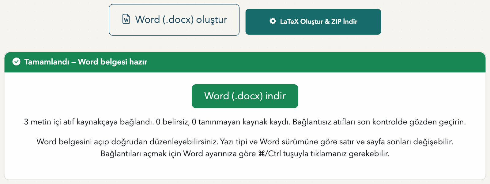

Panelde atıf bağlantılarının özeti de görünür (ör. *3 metin içi atıf kaynakçaya bağlandı. 0 belirsiz, 0 tanınmayan kaynak kaydı.*). Belirsiz veya tanınmayan kayıtlar varsa son kontrolde bu atıfları gözden geçirin.

Word belgesini açıp doğrudan düzenleyebilirsiniz. Dergi kapağı, logo, makale bilgileri, tablolar, görseller ve üst/alt bilgiler dergi ayarlarınıza göre oluşturulur.

> **Bilmeniz gerekenler:** Yazı tipi bilgisayarınızda yüklü değilse veya farklı bir Word sürümü kullanıyorsanız satır ve sayfa sonları değişebilir. Word içindeki bağlantıları açmak için ayarınıza bağlı olarak **⌘/Ctrl + tıklama** gerekebilir. Word çıktısı formdaki bilgilerden üretilir; Overleaf'te sonradan düzenlediğiniz `.tex` dosyasını Word'e dönüştürmez.
>
> **Otomatik sayfa aralığı:** Bitiş sayfası boş bırakıldığında Word, belgeyi açarken *“Bu belge, başka dosyalara başvurabilecek alanlar içeriyor. Belgedeki alanları güncelleştirmek istiyor musunuz?”* diye sorabilir. **Evet** deyin; son sayfa numarası güncellenir. Belgede değişiklik yaptıktan sonra numarayı yenilemek için tümünü seçip **F9** (Mac'te **Fn + F9**) tuşuna basabilirsiniz.

### 7.2 PDF için LaTeX projesi (Overleaf)

1. **LaTeX Oluştur & ZIP İndir** düğmesine tıklayın.
2. *Tamamlandı – ZIP hazır* panelinde **ZIP İndir** ile dosyayı kaydedin.

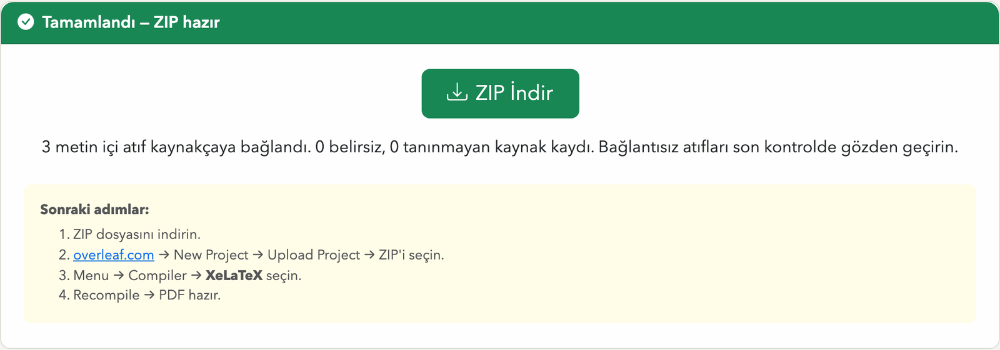

3. [overleaf.com](https://www.overleaf.com) adresinde hesabınıza girin ve **New Project → Upload Project** yolunu izleyerek ZIP dosyasını yükleyin.
4. Sol üstteki **Menu → Compiler** ayarını **XeLaTeX** yapın.
5. **Recompile** düğmesine tıklayın. PDF sağ tarafta oluşur; **Download PDF** ile indirebilirsiniz.

ZIP içinde `main.tex`, derginizin logosu, makalenin görselleri ve kısa bir kullanım açıklaması bulunur. Overleaf'te küçük metin düzeltmelerini doğrudan `main.tex` üzerinde yapabilirsiniz; ancak bu değişiklikler AI-ditor Plus'taki makale kaydına geri aktarılmaz. Büyük değişiklikleri uygulamada yapıp çıktıyı yeniden almanız önerilir.

### 7.3 Hangi çıktıyı seçmeliyim?

| İhtiyaç | Önerilen çıktı |
| --- | --- |
| Yazara veya hakeme düzenlenebilir dosya göndermek, son düzeltmeleri Word'de yapmak | **Word (.docx)** |
| Yayınlanacak nihai PDF'i tutarlı tipografiyle üretmek | **LaTeX ZIP → Overleaf → PDF** |
| Her ikisi | Önce Word ile içeriği yazarla kesinleştirin, ardından aynı kayıttan LaTeX ZIP alın. |

---

## 8. Yedekleme ve başka bilgisayara taşıma

### Neler nerede saklanır?

Hesaplar, dergi ayarları ve makaleler **yalnızca bu bilgisayarda**, uygulamanın dışında bir veri klasöründe tutulur. Bu sayede uygulamayı güncellemek verilerinizi silmez.

| Sistem | Veri klasörü |
| --- | --- |
| macOS | `~/Library/Application Support/AI-ditor Plus/` |
| Windows | `%LOCALAPPDATA%/AI-ditor Plus/` |
| Linux | `~/.local/share/aiditor-plus/` |

### Düzenli yedek alın

- **Dergi ayarları:** *Dergi tasarımı ve ayarları* sekmesinde **Dergi ayarlarını yedekle** ([5.7](#57-dergi-ayarlarını-yedekleme)).
- **Her makale:** Düzenleyicinin altındaki **Makale JSON yedeği al** düğmesi. Yedek; kapak bilgileri, yazarlar, bölümler, tablolar ve şekil dosyalarını içerir. Eksik bıraktığınız alanlar da olduğu gibi saklanır.
- **Tam yedek:** Uygulama kapalıyken yukarıdaki veri klasörünün tamamını kopyalayın.

### Başka bilgisayara geçiş

1. Eski bilgisayarda dergi ayarlarının ve makalelerin JSON yedeklerini alın.
2. Yeni bilgisayara AI-ditor Plus'ı kurun ve bir hesap oluşturun.
3. **Dergi ayarlarını içe aktar** ile ayar yedeğini yükleyin.
4. **Makaleler** sekmesinde **Makale yedeği aç** ile her makale yedeğini yükleyin; makaleler arşive eklenir.

---

## 9. Sık sorulan sorular ve sorun giderme

**macOS uygulamanın açılmasına izin vermiyor.**
Uygulama Apple noter onayına sahip değildir. **Sistem Ayarları → Gizlilik ve Güvenlik** bölümünden **Yine de Aç** seçeneğini kullanın.

**Parolamı unuttum.**
Parola sıfırlama özelliği yoktur. Yeni bir hesap açın; daha önce aldığınız dergi ayarı ve makale JSON yedeklerini içe aktarın.

**Word dosyamı içe aktardım ama bazı bölümler eksik veya karışık.**
Word'deki başlıkların *Başlık 1/2/3* stilleriyle biçimlendirildiğinden emin olun. Metin kutuları, Word şekilleri ve resim olarak eklenmiş tablolar aktarılamayabilir; bunları **Şekil Ekle** veya **Word'den Tablo Yapıştır** ile ekleyin. Eksik bölümü **Bölüm Ekle** ile açıp Word'den metni yapıştırabilirsiniz.

**Yazar, DOI ve tarih bilgileri aktarılmadı.**
Bu beklenen bir durumdur. Bu bilgiler Word dosyalarında standart bir yerde bulunmadığından elle girilmelidir ([6.3](#63-kapak-sayfası-bilgileri-1), [6.4](#64-yazarlar-2)).

**İlk sayfa taşıyor, özet ikinci sayfaya kayıyor.**
Kapak bilgilerinde **İlk sayfa yerleşimi** ayarını *Sıkı* veya *Çok sıkı* yapın. Dergi ayarlarında **Kapak dipnot düzeni** için *Kısa* veya *Sade* seçeneği de ilk sayfada yer açar.

**Bazı atıflar kaynakçaya bağlanmadı.**
Atıf eşleştirmesi APA yazar–yıl biçimini destekler. Aynı yazar ve yıla ait birden fazla kayıt, numaralı atıf stilleri ve standart dışı kaynak biçimleri otomatik eşleştirilemeyebilir. Her kaynağın kaynakçada ayrı satırda olduğundan emin olun. Bağlanmayan atıflar metinde olduğu gibi kalır; içerik kaybı olmaz.

**Word'deki tek/çift sayfa üst bilgileri yanlış görünüyor.**
LibreOffice çift sayıdan başlayan belgelerde tek/çift düzenini farklı yorumlayabilir. Microsoft Word'de veya LaTeX PDF'inde kontrol edin.

**Sayfa aralığında son sayfa yerine “…” veya “??” görünüyor.**
Bitiş sayfası boş bırakıldığında son sayfa otomatik hesaplanır. Word'de alanları güncelleyin (tümünü seçip **F9** / Mac'te **Fn + F9**). Overleaf'te **Recompile** düğmesine bir kez daha tıklayın; LaTeX son sayfayı ikinci derlemede yerleştirir.

**Overleaf'te derleme hata veriyor.**
**Menu → Compiler** ayarının **XeLaTeX** olduğundan emin olun. ZIP'i açmadan, olduğu gibi **Upload Project** ile yükleyin.

**ZIP dosyası “desteklenmeyen biçim” hatası veriyor.**
Bu sorun 2.0.3 sürümünde giderilmiştir. Uygulamayı güncelleyin, makaleyi açın ve LaTeX çıktısını yeniden oluşturun.

**Uygulamayı güncellersem verilerim silinir mi?**
Hayır. Veriler uygulama paketinin dışında saklanır. Yine de güncellemeden önce yedek almanız iyi bir alışkanlıktır.

**Uygulama verilerimi internete gönderiyor mu?**
Hayır. Uygulama yalnızca bilgisayarınızın yerel adresinde çalışır. Bulut hesabı, eşitleme veya uzaktan erişim yoktur.

---

## 10. Yayın öncesi kontrol listesi

Çıktıyı yayımlamadan önce şunları kontrol edin:

- [ ] Türkçe ve İngilizce başlıklar, özetler ve anahtar kelimeler doğru.
- [ ] Yazar adları, ünvanları, kurumları, ORCID'ler ve sorumlu yazar doğru.
- [ ] Yıl, cilt, sayı, sayfa aralığı ve DOI doğru; DOI bağlantısı açılıyor.
- [ ] Geliş, kabul ve yayın tarihleri girildi.
- [ ] Etik beyan, katkı oranı ve çıkar çatışması beyanları eksiksiz (uygulama bunları kendiliğinden doldurmaz).
- [ ] Bölüm sırası ve başlık düzeyleri doğru.
- [ ] Bütün tablo ve şekiller doğru bölümde, doğru numara ve başlıkla yer alıyor.
- [ ] Kaynakça her satırda bir kaynak olacak şekilde düzenli; atıf özetindeki belirsiz kayıtlar kontrol edildi.
- [ ] Üst/alt bilgiler, tek/çift sayfalar ve sayfa numaraları beklenen biçimde.
- [ ] Son görünüm Word'de veya Overleaf PDF'inde kontrol edildi.
- [ ] Makalenin JSON yedeği alındı.

---

## Lisans

AI-ditor Plus, akademik dergi editörlerinin işlerini kolaylaştırmak amacıyla kâr amacı güdülmeden geliştirilmiştir ve [MIT lisansıyla](../LICENSE) yayımlanır. Yazılım lisansı, hazırladığınız makalelerin veya derginizin yayın lisansını belirlemez; makale lisansı dergi tarafından seçilir.

Geliştirici: **Alparslan Güvenç** · [GitHub deposu](https://github.com/alparslanguvenc/aiditor-plus) · [Sürüm notları](../CHANGELOG.md)

<sub>Bu kılavuzdaki ekran görüntüleri `python scripts/guide_screenshots.py` komutuyla, kurgusal örnek verilerle yeniden üretilebilir.</sub>
